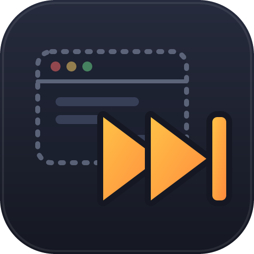
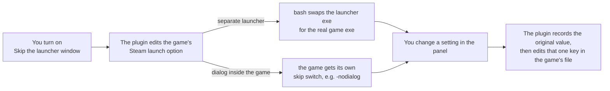

<p align="center">
  
</p>

<h1 align="center">Skip Launcher</h1>

<p align="center">
  <b>Start your games straight into the game on the Steam Deck: no launcher window, controller only.</b><br>
  A <a href="https://github.com/SteamDeckHomebrew/decky-loader">Decky Loader</a> plugin. Per game. Reversible. Open source.
</p>

<p align="center">
  <a href="https://github.com/evertonfxavier/skip-launcher/actions/workflows/build-plugin.yml"></a>
  <a href="https://github.com/evertonfxavier/skip-launcher/releases/latest"></a>
  <a href="LICENSE"></a>
  
</p>

<p align="center"><b>English</b> · <a href="README.pt-BR.md">Português (Brasil)</a></p>

---

## What is this?

Some older PC games open a small **launcher window** before the game: a screen for resolution, quality or controls with a *Play*
button that only works with a mouse. On a Steam Deck docked to a TV, with only a controller, that window breaks the immersion, or
blocks you completely. Skip Launcher makes Steam start the game itself and moves what that window held into the plugin, where
a controller reaches it.

> **Example.** *Batman: Arkham Asylum* opens a launcher where you pick the resolution and click *Launch*. Turn on **Skip the
> launcher window** in the plugin and the game starts straight away; change the resolution, anti-aliasing or detail level
> from the same panel, with the controller.

## Highlights

- **One switch per game:** *Skip the launcher window*. Off puts the launch option back as it was.
- **The settings of the window, in the plugin:** the choices the launcher used to save (resolution, detail, subtitles…) as toggles and dropdowns you can reach with a controller.
- **No game file is touched.** Skipping is only a launch option in Steam, so game updates and *Verify integrity of game files* cannot undo it, or be harmed by it.
- **Your originals are safe.** The value of every setting is recorded before the first change; **Put the original settings back** restores exactly those, key by key.
- **Careful by design.** It writes nothing while the game runs, never creates or guesses a settings file, and keeps the launch options you already had.
- **Nothing to configure, no root, no internet.**

## Quick start

You need a Steam Deck with [Decky Loader](https://github.com/SteamDeckHomebrew/decky-loader) installed.

1. **Download** `skip-launcher-vX.Y.Z.zip` from the [latest release](https://github.com/evertonfxavier/skip-launcher/releases/latest) and get it onto the Deck
   (download it in Desktop Mode, or copy it over from your PC). A `.sha256` file sits next to it if you want to check the download.
2. **Turn on Decky's Developer Mode.** In Game Mode press the **Quick Access** button (**···**), open **Decky**, then the
   **⚙ Settings** page, and switch **Developer Mode** on. It only unlocks installing a plugin from a file.
3. **Install the plugin.** In Decky's settings open the **Developer** section and choose **Install Plugin from ZIP**, then pick the file.
4. **Use it.** Open **Skip Launcher** from Decky's plugin list, pick a game, turn on **Skip the launcher window**, and start the game.

## Supported games

The list of games, what each one changes and how sure we are about it lives in **[SUPPORTED_GAMES.md](SUPPORTED_GAMES.md)** (it is
generated from the code, so it is always up to date). Today: Batman: Arkham Asylum GOTY Edition, Max Payne and Max Payne 2.

Every launcher keeps its choices somewhere different, so each game needs its own *profile*. Yours is missing?
[Request it](https://github.com/evertonfxavier/skip-launcher/issues/new?template=game_request.yml) or [add it yourself](docs/adding-a-game.md).

## Using it

Pick a game. The first switch is the skip; the groups below it are the settings the launcher window used to hold. Changes apply the next time the game starts.

| What you see | What it means |
|--------------|---------------|
| *The game starts straight away* | The skip is on. |
| *The game is open. Close it to change settings* | Nothing is written while the game, or its Wine session, runs. Close it and try again. |
| *The game is installing or updating* | Wait for Steam to finish. |
| *The game has not saved its settings yet* | Turn off the skip, start the game once and press the window's *Play* button so it saves its settings, then come back. The plugin never creates that file. |
| *Custom: set outside the plugin* | The game's file has a value the plugin does not offer; it leaves it alone until you pick one. |

## Is it safe?

Short answer: it was built so that you can always go back. The longer answer is in the [FAQ](docs/faq.md#is-it-safe-for-my-games).

- **What it changes:** the game's launch option in Steam, and, for the settings, only the keys of the game's own settings file inside its Proton prefix.
- **How you go back:** turn the switch off, press **Put the original settings back**, or clear the launch option in Steam (game, Properties, General).
- **Uninstalling the plugin:** first turn the skip off for each game, then remove the plugin from Decky. If you forget, clear the launch option in Steam by hand.
- **Online games:** only offline-friendly games are supported; changing how an anti-cheat game starts can get an account banned.
- **No game files are shipped.** The plugin contains no game assets.

## Something went wrong?

1. Read the [FAQ and troubleshooting](docs/faq.md).
2. Still stuck? [Open a bug report](https://github.com/evertonfxavier/skip-launcher/issues/new?template=bug_report.yml). The form tells you which log to attach (`~/homebrew/logs/Skip Launcher/`).
3. Played a game with the plugin? [Tell us how it went](https://github.com/evertonfxavier/skip-launcher/issues/new?template=deck_report.yml): it is the most valuable thing you can do, because nobody can confirm a game starts and keeps its settings without playing it.

## How it works



- Every game gets a **profile** that knows what Steam starts, how to skip it, where *that* launcher keeps its choices (an `.ini` file, or the Windows registry, which under Proton is a text file) and which values each option writes.
- **Put the original settings back** never restores a whole file: it puts back each key the plugin changed, so it is exact even if the game rewrote the rest of the file meanwhile.

Want the engineering view? Read [docs/architecture.md](docs/architecture.md).

## Contributing

**You do not need to be a programmer to help.** The project is young and every game is a new puzzle.

| I want to… | Effort | Start here |
|------------|--------|------------|
| Tell whether a game works on a Deck | 5 min | [Deck report](https://github.com/evertonfxavier/skip-launcher/issues/new?template=deck_report.yml) |
| Ask for a game | 5 min | [Game request](https://github.com/evertonfxavier/skip-launcher/issues/new?template=game_request.yml) |
| Fix a typo, improve the docs, translate | 15 min | [CONTRIBUTING.md](CONTRIBUTING.md) |
| Add support for a game | a few hours | [docs/adding-a-game.md](docs/adding-a-game.md) |
| Improve the engine or the UI | varies | [docs/development.md](docs/development.md) |

Everyone is expected to follow the [Code of Conduct](CODE_OF_CONDUCT.md). Found a security problem? See [SECURITY.md](SECURITY.md).

## Build from source

```bash
pnpm install
pnpm test             # backend tests (they never need game files)
pnpm run build:zip    # out/skip-launcher-vX.Y.Z.zip
```

Requirements: Node.js 20+, pnpm 9+, Python 3.9+. More in [docs/development.md](docs/development.md).
Releases are published automatically on every push to `main`.

## Credits and legal

- **Logo:** original artwork of this project.
- **Template:** based on the [decky-plugin-template](https://github.com/SteamDeckHomebrew/decky-plugin-template).
- **Trademarks:** Steam, Proton and the game titles belong to their owners. This is an unofficial community project, not affiliated with or endorsed by Valve or any game publisher.
- **Game files:** the plugin ships no game assets and never modifies the files of a game; it edits only the settings of the copy you already own.

## License

[BSD 3-Clause](LICENSE).
