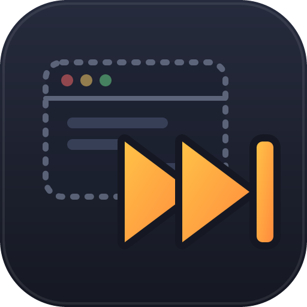

<p align="center">
  
</p>

<h1 align="center">Skip Launcher</h1>

<p align="center">
  <b>Abra seus jogos direto no jogo no Steam Deck: sem a janela do launcher, só com o controle.</b><br>
  Um plugin do <a href="https://github.com/SteamDeckHomebrew/decky-loader">Decky Loader</a>. Por jogo. Reversível. Código aberto.
</p>

<p align="center">
  <a href="https://github.com/evertonfxavier/skip-launcher/actions/workflows/build-plugin.yml"></a>
  <a href="https://github.com/evertonfxavier/skip-launcher/releases/latest"></a>
  <a href="LICENSE"></a>
  
</p>

<p align="center"><a href="README.md">English</a> · <b>Português (Brasil)</b></p>

---

## O que é isto?

Alguns jogos de PC mais antigos abrem uma **janelinha de launcher** antes do jogo: uma tela de resolução, qualidade ou controles com um
botão *Jogar* que só funciona com mouse. No Steam Deck ligado na TV, só com o controle, essa janela quebra a imersão ou trava você por completo.
O Skip Launcher faz a Steam abrir o jogo direto e leva para dentro do plugin o que a janela guardava, onde o controle alcança.

> **Exemplo.** *Batman: Arkham Asylum* abre um launcher onde você escolhe a resolução e clica em *Launch*. Ligue **Pular a janela do
> launcher** no plugin e o jogo abre na hora; mude resolução, antialiasing ou nível de detalhe no mesmo painel, com o controle.

## Destaques

- **Um interruptor por jogo:** *Pular a janela do launcher*. Desligado, a opção de inicialização volta como estava.
- **As configurações da janela, dentro do plugin:** o que o launcher salvava (resolução, detalhe, legendas…) vira interruptores e listas que o controle alcança.
- **Nenhum arquivo do jogo é alterado.** Pular é só uma opção de inicialização na Steam, então atualizações e *Verificar integridade dos arquivos* não desfazem nada, nem são prejudicadas.
- **Seus originais ficam seguros.** O valor de cada configuração é guardado antes da primeira mudança; **Voltar às configurações originais** restaura exatamente esses valores, chave por chave.
- **Cuidadoso por construção.** Não escreve nada com o jogo aberto, nunca cria nem adivinha um arquivo de configuração e mantém as opções de inicialização que você já tinha.
- **Nada para configurar, sem root, sem internet.**

## Começo rápido

Você precisa de um Steam Deck com o [Decky Loader](https://github.com/SteamDeckHomebrew/decky-loader) instalado.

1. **Baixe** o `skip-launcher-vX.Y.Z.zip` da [última versão](https://github.com/evertonfxavier/skip-launcher/releases/latest) e leve para o Deck
   (baixe no Modo Desktop ou copie do seu PC). Há um arquivo `.sha256` ao lado, se quiser conferir o download.
2. **Ligue o Modo Desenvolvedor do Decky.** No Modo Jogo, aperte o botão **Acesso Rápido** (**···**), abra o **Decky**, depois **⚙ Configurações**, e
   ligue **Modo Desenvolvedor**. Ele só libera instalar um plugin a partir de um arquivo.
3. **Instale o plugin.** Nas configurações do Decky, abra **Desenvolvedor** e escolha **Instalar plugin de ZIP**, depois selecione o arquivo.
4. **Use.** Abra o **Skip Launcher** na lista de plugins do Decky, escolha um jogo, ligue **Pular a janela do launcher** e abra o jogo.

## Jogos suportados

A lista de jogos, o que cada um altera e o quanto temos certeza está em **[SUPPORTED_GAMES.md](SUPPORTED_GAMES.md)** (em inglês; é gerada a
partir do código, então está sempre em dia). Hoje: Batman: Arkham Asylum GOTY Edition, Max Payne e Max Payne 2.

Cada launcher guarda suas escolhas num lugar diferente, então cada jogo precisa do seu próprio *perfil*. Falta o seu?
[Peça aqui](https://github.com/evertonfxavier/skip-launcher/issues/new?template=game_request.yml) ou [adicione você mesmo](docs/adding-a-game.md).

## Como usar

Escolha um jogo. O primeiro interruptor é o de pular; os grupos abaixo são as configurações que a janela do launcher guardava. As mudanças valem na próxima vez que o jogo abrir.

| O que você vê | O que significa |
|---------------|-----------------|
| *O jogo abre direto* | O pulo está ligado. |
| *O jogo está aberto. Feche-o para mudar as configurações* | Nada é escrito com o jogo (ou a sessão do Wine dele) aberto. Feche e tente de novo. |
| *O jogo está instalando ou atualizando* | Espere a Steam terminar. |
| *O jogo ainda não salvou as configurações* | Desligue o pulo, abra o jogo uma vez e aperte o botão de jogar da janela para ele salvar as configurações, depois volte. O plugin nunca cria esse arquivo. |
| *Personalizado: definido fora do plugin* | O arquivo do jogo tem um valor que o plugin não oferece; ele deixa como está até você escolher um. |

## É seguro?

Resposta curta: foi feito para você poder sempre voltar atrás. A resposta longa está no [FAQ](docs/faq.md#is-it-safe-for-my-games) (em inglês).

- **O que altera:** a opção de inicialização do jogo na Steam e, nas configurações, só as chaves do arquivo de configuração do próprio jogo dentro do prefixo Proton.
- **Como voltar:** desligue o interruptor, aperte **Voltar às configurações originais** ou limpe a opção de inicialização na Steam (jogo, Propriedades, Geral).
- **Desinstalar o plugin:** primeiro desligue o pulo de cada jogo, depois remova o plugin do Decky. Se esquecer, limpe a opção de inicialização na Steam à mão.
- **Jogos online:** só há suporte a jogos que funcionam offline; mudar como um jogo com anti-cheat abre pode render banimento.
- **Nenhum arquivo de jogo é distribuído.** O plugin não contém nada dos jogos.

## Algo deu errado?

1. Leia o [FAQ e solução de problemas](docs/faq.md) (em inglês).
2. Continua travado? [Abra um relato de bug](https://github.com/evertonfxavier/skip-launcher/issues/new?template=bug_report.yml). O formulário diz qual log anexar (`~/homebrew/logs/Skip Launcher/`).
3. Jogou com o plugin? [Conte como foi](https://github.com/evertonfxavier/skip-launcher/issues/new?template=deck_report.yml): é a coisa mais valiosa que você pode fazer, porque ninguém confirma que um jogo abre e mantém as configurações sem jogar.

## Como funciona

- Cada jogo tem um **perfil** que sabe o que a Steam abre, como pular, onde *aquele* launcher guarda suas escolhas (um arquivo `.ini` ou o registro do Windows, que no Proton é um arquivo de texto) e quais valores cada opção grava.
- Há dois jeitos de pular: quando o launcher é um programa separado, uma opção de inicialização troca o executável do launcher pelo do jogo; quando a janela é um diálogo do próprio jogo, a opção acrescenta o argumento que o jogo já entende (por exemplo `-nodialog`).
- **Voltar às configurações originais** nunca restaura um arquivo inteiro: devolve cada chave que o plugin mudou, então é exato mesmo que o jogo tenha reescrito o resto do arquivo.

A visão de engenharia está em [docs/architecture.md](docs/architecture.md) (em inglês).

## Contribuindo

**Você não precisa programar para ajudar.** O projeto é jovem e cada jogo é um quebra-cabeça novo.

| Quero… | Esforço | Comece aqui |
|--------|---------|-------------|
| Contar se um jogo funciona no Deck | 5 min | [Relato do Deck](https://github.com/evertonfxavier/skip-launcher/issues/new?template=deck_report.yml) |
| Pedir um jogo | 5 min | [Pedido de jogo](https://github.com/evertonfxavier/skip-launcher/issues/new?template=game_request.yml) |
| Corrigir um erro de digitação, melhorar a documentação, traduzir | 15 min | [CONTRIBUTING.md](CONTRIBUTING.md) |
| Adicionar suporte a um jogo | algumas horas | [docs/adding-a-game.md](docs/adding-a-game.md) |
| Melhorar o motor ou a interface | varia | [docs/development.md](docs/development.md) |

Esperamos que todos sigam o [Código de Conduta](CODE_OF_CONDUCT.md). Achou um problema de segurança? Veja o [SECURITY.md](SECURITY.md).

## Compilar a partir do código

```bash
pnpm install
pnpm test             # testes do backend (nunca precisam de arquivos de jogo)
pnpm run build:zip    # out/skip-launcher-vX.Y.Z.zip
```

Requisitos: Node.js 20+, pnpm 9+, Python 3.9+. Mais em [docs/development.md](docs/development.md).
As versões são publicadas automaticamente a cada push na `main`.

## Créditos e aviso legal

- **Logo:** arte original deste projeto.
- **Modelo:** baseado no [decky-plugin-template](https://github.com/SteamDeckHomebrew/decky-plugin-template).
- **Marcas:** Steam, Proton e os títulos dos jogos pertencem aos seus donos. Este é um projeto comunitário não oficial, sem vínculo nem aprovação da Valve ou de qualquer publicadora.
- **Arquivos de jogo:** o plugin não distribui nada dos jogos e nunca modifica os arquivos de um jogo; só edita as configurações da cópia que você já tem.

## Licença

[BSD 3-Clause](LICENSE).
