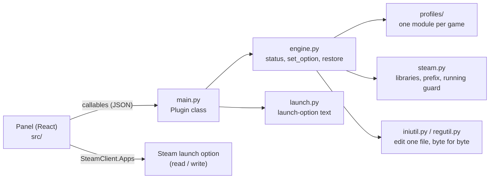

# Architecture

A Decky plugin has two halves. The **backend** (Python, standard library only, runs as the `deck` user) reads and writes files. The
**frontend** (React with `@decky/ui`, runs inside Steam's UI) shows the panel and is the only part that can read and write a game's Steam
**launch option**, because Steam keeps that value in memory and rewrites its own files on exit.

## What happens when you use it

1. **Skip switch.** The UI reads the game's launch options from Steam, asks the backend what the text should become
   (`plan_launch_option`), writes it back with `SetAppLaunchOptions` and reads it again to check that Steam kept it.
2. **A setting.** The UI calls `set_option(appid, setting, option)`. The engine checks the game is not running, reads the settings file,
   records the originals, writes the new lines atomically and answers with a status. The UI then asks `get_game` for the new state.
3. **Put the original settings back.** The engine writes every recorded original back, key by key, and clears the record.

## Two ways to skip a launcher window

| Kind | When | Launch option | Example |
|------|------|---------------|---------|
| **Executable swap** | The launcher is a separate program that Steam starts and that then starts the game | `bash -c 'exec "${@/Launcher.exe/Game.exe}"' _ %command%`: Steam builds the whole Proton command, bash rewrites the one argument that names the launcher | Batman: Arkham Asylum |
| **Command-line switch** | The window is a dialog of the game's own executable, and the game accepts a switch to skip it (`skip_args` in the profile) | `%command% -nodialog` | Max Payne, Max Payne 2 |

Both keep every other launch option the player has (`launch.py`, round-trip tested): turning the skip off removes only the added text.

## Two kinds of settings file

| Kind (`config_format`) | Adapter | Notes |
|------|---------|-------|
| `ini` | `iniutil.py` `IniText` | UTF-16 (with BOM) or UTF-8, any newline. Keeps BOM, newline and every untouched line byte for byte; the last assignment of a key wins, as in Unreal |
| `reg` | `regutil.py` `RegText` | Wine's `user.reg`: section names with doubled backslashes and a time stamp (`[Software\\Remedy Entertainment\\Max Payne\\Video Settings] 1795560333`), values like `"Display Width"=dword:00000780`. Never creates a section |

Both expose the same small interface (`get`, `set`, `remove`, `has_section`, `dumps`), so the engine does not care which one it has.
A profile may also name a `required_section` or `required_key`: until the game itself has saved it, the status is `no_config` and nothing is written.

## Profiles

A **profile** (`py_modules/skip_launcher/profiles/<game>.py`) is a class with facts and data, no logic:

| Field | Meaning |
|-------|---------|
| `appid`, `name`, `revision` | Steam app id (a string), display name, bumped when what an option writes changes meaning |
| `launcher_exe`, `game_exe` | The program Steam starts and the real game (equal when the window is a dialog of the game itself) |
| `skip_args` | Set for the command-line kind: the switch to add (`-nodialog`) |
| `config_rel`, `config_format` | The settings file relative to the Proton prefix (`pfx/`), and `ini` or `reg` |
| `required_section`, `required_key` | What must exist before the plugin offers anything |
| `settings` | A tuple of `Setting`s |

A **Setting** is a `toggle` or a `choice` made of **Options**. One option sets one or more `(section, key, value)` entries: a resolution is
`ResX` + `ResY`, a Batman detail level is twelve keys. The current option is the one whose entries **all** match the file; if none does, it
reads as *custom* and the UI says so.

## State and recovery

`~/homebrew/settings/Skip Launcher/config.json` holds, per game, the `originals` (key id → value before our first change, `null` = absent), a
checksum of the backup and the last event. The backup of the whole settings file is `backups/<appid>/<file>.orig`.

Write order for `set_option`:

1. read the file and decide what would change (nothing changes if the file already has the values);
2. on the first change since the last restore, save the whole-file copy;
3. record the originals of the keys about to change, and **save the config**;
4. write the new file through a temp file, `fsync` and `os.replace`.

A crash after step 3 and before step 4 leaves the file untouched and a record that restoring can apply (restoring a value that was never
changed is harmless). A crash during step 4 leaves the old or the new file, never half of one.

`restore` writes each recorded original back (removing keys that did not exist), then clears the record. It works even if the game
rewrote other parts of the file meanwhile, because it never restores the whole file.

## Status codes

Every status is `{state, code, message}`: `state` is `ok`, `pending`, `running` or `error`; `code` is stable and listed in `status_codes.py`; `message` is
English and only a fallback. The UI translates `code` (`code.<code>` in each catalog). `tests/test_consistency.py` fails when a code the engine uses is
missing from the list or a catalog.

| Code | Meaning |
|------|---------|
| `ok` | ready |
| `not_installed`, `not_ready` | the game is not installed / is installing or updating |
| `running` | the game, or Wine's session of its prefix, is alive |
| `no_config` | the game has not saved its settings yet |
| `unreadable` | the settings file cannot be decoded |
| `write_failed` | the write failed; the old file is intact |
| `unknown_setting`, `unknown_game` | the request names something that does not exist |

## The running-game guard (`steam.py`)

A game is running when a process runs from its install folder (in any spelling: as reported, real path, the `Z:\` form Proton uses), or when
Steam's launcher carries `AppId=<appid>` as a whole token. For settings kept in the registry, the guard also checks every process's
`WINEPREFIX` / `STEAM_COMPAT_DATA_PATH`, because `wineserver` outlives the game for a moment and saves `user.reg` when it exits.

## UI (`src/`)

One panel, never a full-screen spinner: the game select, the **Skip the launcher window** switch, the settings grouped as toggles and dropdowns,
and **Put the original settings back** once something changed. Only controller-friendly components (`ToggleField`, `DropdownItem`,
`ButtonItem`). All text goes through `t()` / `tOr()` with `en.json` as the source. The chosen game is kept outside the component
(`useSkipLauncher.ts`) because Steam can remount the panel.

## Adding things

- A **game**: [adding-a-game.md](adding-a-game.md).
- A new **kind of settings file**: write an adapter with the same interface as `IniText`, add it to `engine._read`, give it the tests listed in
  [safety-rules.md](safety-rules.md), and document it here.
